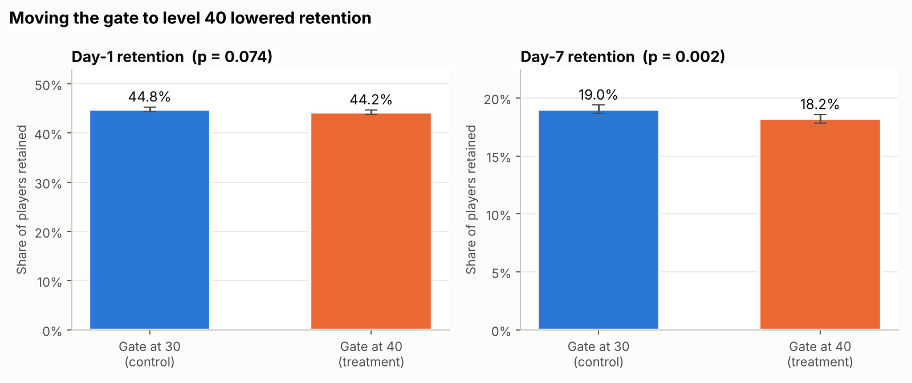

# Learner Retention & A/B Testing Analysis

**What keeps people coming back to a learning app, and how do you test a product change?**

This project answers two product-analytics questions with SQL and statistics:

1. **Retention and forgetting:** analysis of **~13 million real Duolingo practice records**:
   cohort retention curves, retention by language course, a forgetting curve, the hardest
   words per course, and engagement segments.
2. **Experimentation:** a full A/B test readout on **90,189 players** of a mobile game that tested
   moving its first progress gate from level 30 to level 40.

**Tools:** SQL (DuckDB; CTEs, window functions, cohort logic) · Python (pandas, SciPy, statsmodels) ·
Matplotlib · Tableau-ready CSV exports

---

## Part 1: A/B test, gate at level 30 vs. level 40



| Metric | Gate 30 (control) | Gate 40 (treatment) | Difference | p-value |
|---|---|---|---|---|
| Day-1 retention | 44.82% | 44.23% | −0.59 pts | 0.074 |
| Day-7 retention | 19.02% | 18.20% | **−0.82 pts (−4.3%)** | **0.0016** |

**Recommendation: keep the gate at level 30.** Day-7 retention dropped significantly with the later gate.
A bootstrap with 2,000 resamples agrees: control won in 99.9% of them.

**What I checked beyond the headline:**
- **Sample ratio mismatch (SRM):** treatment received 50.44% of players instead of 50%, which is
  significant (χ² p = 0.009). This often signals an assignment or logging bug, so I flagged it as a
  caveat instead of ignoring it.
- **Outliers:** one player logged 49,854 rounds. Removing them doesn't change the result.
- **Power:** the test could detect about a 0.9-pt change in Day-1 retention, so the Day-1 non-result
  means "no large effect", not "no effect".
- **Post-treatment bias:** rounds played happen *after* assignment, so engagement splits are
  reported as descriptive only, not causal.

Full write-up: [`outputs/ab_test_results.md`](outputs/ab_test_results.md)

---

## Part 2: Duolingo learner retention & forgetting

Data: Duolingo's public spaced-repetition dataset (Settles & Meeder, ACL 2016). Each row is one word
practiced by one learner in one lesson, about 13M rows over two weeks.

| SQL file | Question it answers | Techniques |
|---|---|---|
| `01_data_quality.sql` | Is the data complete and valid? | aggregate checks |
| `02_daily_active_users.sql` | How many learners are active each day? | 7-day rolling average (window) |
| `03_cohort_retention.sql` | Of learners first seen on day D, how many return on day D+N? | CTEs, `DATE_DIFF`, cohort logic, censoring incomplete cohorts |
| `04_retention_by_language.sql` | Which courses retain learners best? | `ARG_MIN`, conditional aggregation, `RANK()` |
| `05_forgetting_curve.sql` | How fast do learners forget words without review? | bucketing with `CASE` |
| `06_hardest_words.sql` | Which words are hardest in each course? | `ROW_NUMBER() OVER (PARTITION BY …)` |
| `07_engagement_segments.sql` | How concentrated is activity among learners? | `NTILE(4)` |
| `08_language_pairs.sql` | Does recall differ by native → target language? | grouping, `HAVING` |

Results, charts, and a write-up with every number computed from the data are generated in
`outputs/duolingo_results.md` after you run the pipeline (see below).

---

## How to run

```bash
pip install -r requirements.txt

# Part 1 (data downloads automatically, ~2.5 MB)
python src/download_ab_data.py
python src/ab_test.py

# Part 2: download the Duolingo file (361 MB) from Harvard Dataverse:
#   https://dataverse.harvard.edu/dataset.xhtml?persistentId=doi:10.7910/DVN/N8XJME
# save it as data/raw/settles.acl16.learning_traces.13m.csv.gz, then:
python src/duolingo_analysis.py
```

Optional pipeline test on a small fake dataset (writes to `outputs/_TEST_ONLY/`, never mixed with real results):

```bash
python tests/make_test_sample.py
python src/duolingo_analysis.py --data tests/fake_traces_sample.csv.gz --test
```

## Dashboard
Every query result is saved as a CSV in `outputs/tableau/` so it can go straight into Tableau Public.
Dashboard link: *[add your Tableau Public link here]*

## Project structure
```
sql/ab_test/       SQL for experiment checks and metrics
sql/duolingo/      SQL for retention, forgetting, segments
src/               Python runners (stats, charts, write-ups)
tests/             fake-data generator for pipeline testing
outputs/           results (.md), figures (.png), Tableau CSVs
```

## Data sources
- Settles, B. & Meeder, B. (2016). *A Trainable Spaced Repetition Model for Language Learning.* ACL. Data: Harvard Dataverse, doi:10.7910/DVN/N8XJME
- Cookie Cats A/B test dataset (Tactile Entertainment, via Kaggle/DataCamp), mirrored at github.com/robguilarr/ab_testing_cookie_cats
